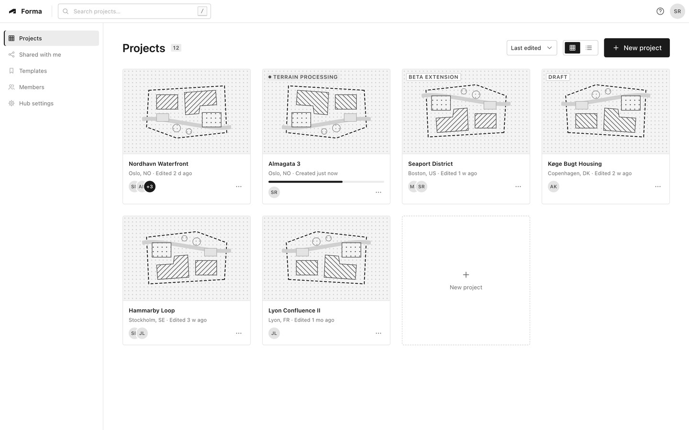
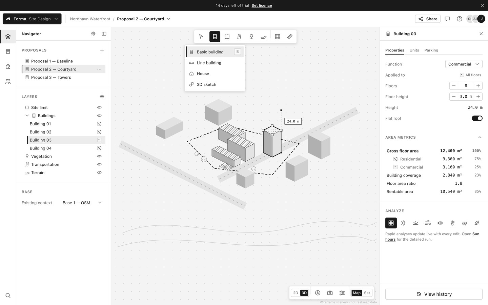
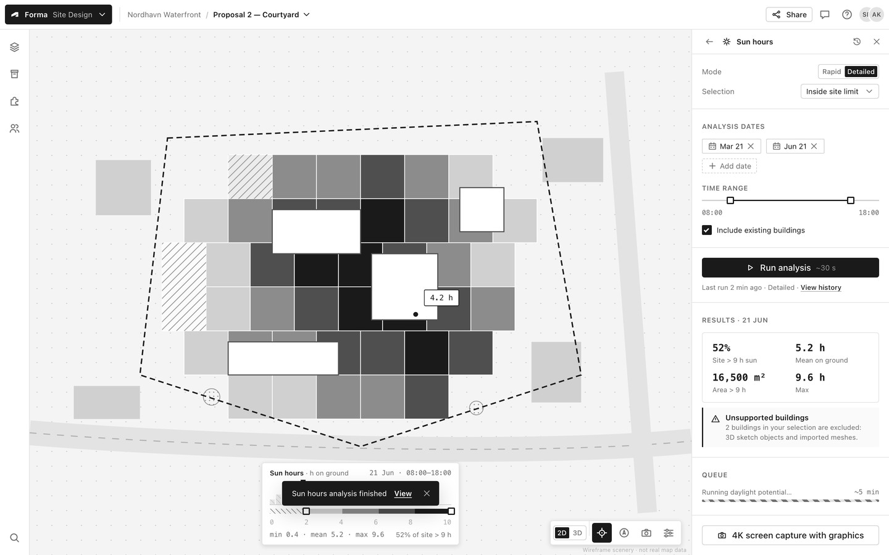
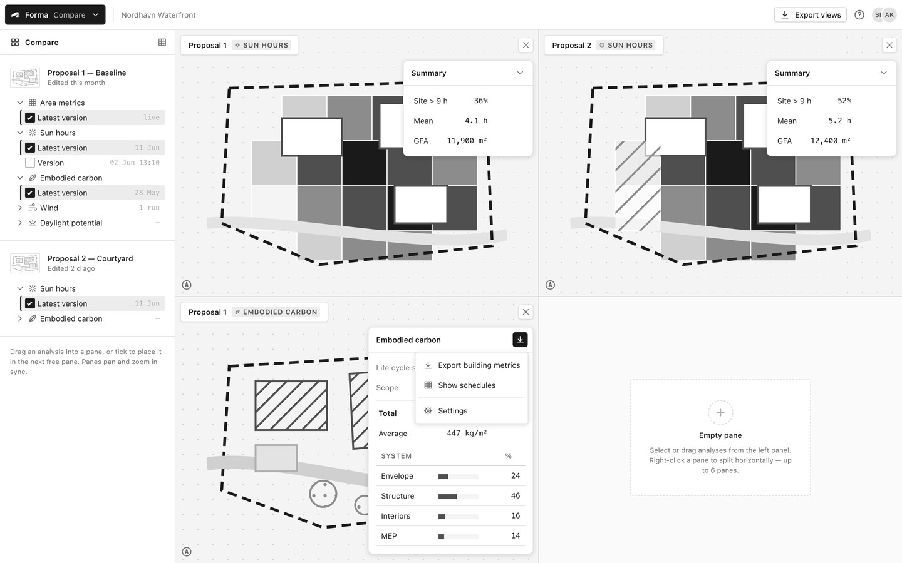
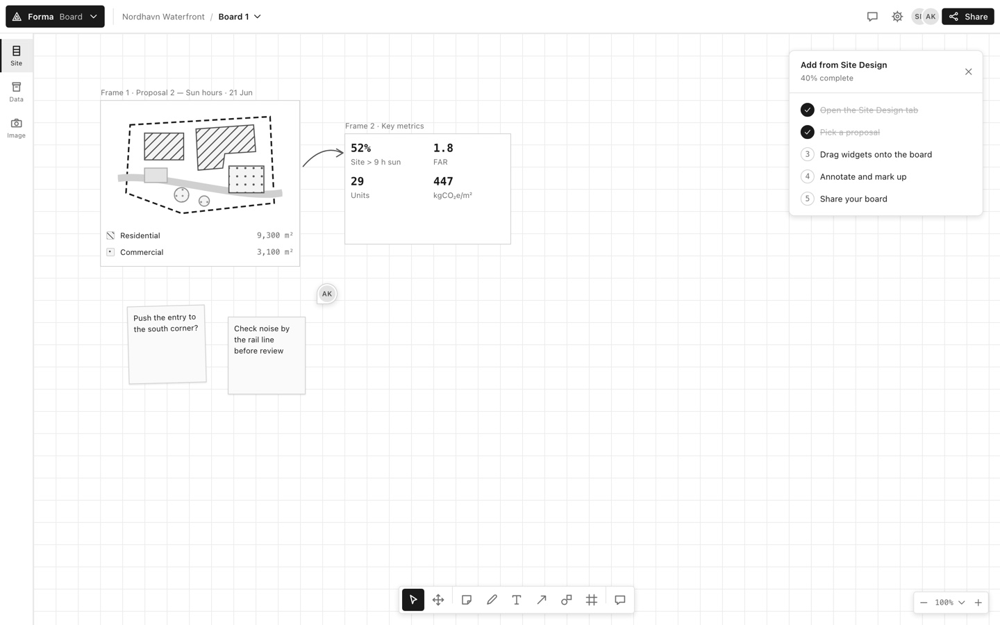
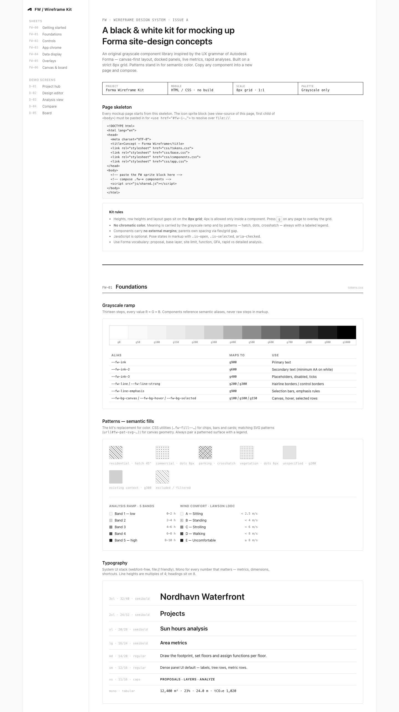

# FW — Forma Wireframe Kit

A **black & white wireframe design system + component library** for mocking up product
concepts in the spirit of **Autodesk Forma Site Design** (and its Compare / Board /
Building Design siblings). It is an **original, simplified system inspired by Forma's UX
grammar** — canvas-first layout, docked panels, live metrics, rapid analyses — not a
pixel clone.

- **Strict 8px grid** — component heights, row heights and layout gaps land on 8;
  4px half-steps are allowed only *inside* components. Press <kbd>g</kbd> on any page
  to overlay the baseline grid.
- **Pure grayscale** — no chromatic color anywhere. Semantic color (function colors,
  analysis heatmaps) is replaced by a 5-band gray ramp + B/W patterns (hatch, dots,
  crosshatch), always with a labeled legend.
- **Static HTML/CSS, zero build** — open any page via `file://` or
  `python3 -m http.server`. Vanilla JS is progressive enhancement only; every page
  reads correctly with JS disabled (states are posed in markup).

## Start here

| File | What it is |
|---|---|
| [`index.html`](index.html) | **The living style guide** — all tokens + every component, organized as drawing sheets FW-00…FW-06 |
| [`demos/dashboard.html`](demos/dashboard.html) | D-01 · Project hub (project cards, new-project modal) |
| [`demos/editor.html`](demos/editor.html) | D-02 · 3D design editor (full shell, axon scene, posed selection + tool flyout) |
| [`demos/analysis.html`](demos/analysis.html) | D-03 · Sun-hours analysis (heatmap, legend with range handles, results panel) |
| [`demos/compare.html`](demos/compare.html) | D-04 · Compare (2×2 synced panes, floating metric cards, empty pane) |
| [`demos/board.html`](demos/board.html) | D-05 · Board whiteboard (frames, stickies, checklist, board toolbar, zoom pill) |

Demos cross-link: the module-switcher chip (top-left) jumps between Design / Compare /
Board; the logo or project breadcrumb returns to the hub; the sun icon in the editor's
Analyze row opens the analysis view.

## Screenshots

| | |
|---|---|
| **D-01 · Project hub**<br>[](docs/screenshots/dashboard.jpg) | **D-02 · Design editor**<br>[](docs/screenshots/editor.jpg) |
| **D-03 · Sun-hours analysis**<br>[](docs/screenshots/analysis.jpg) | **D-04 · Compare**<br>[](docs/screenshots/compare.jpg) |
| **D-05 · Board**<br>[](docs/screenshots/board.jpg) | **Style guide** (top section below; full page in 5 parts)<br>[](docs/screenshots/styleguide-1-of-5.jpg) |

Full style guide capture: [section 1](docs/screenshots/styleguide-1-of-5.jpg) ·
[section 2](docs/screenshots/styleguide-2-of-5.jpg) ·
[section 3](docs/screenshots/styleguide-3-of-5.jpg) ·
[section 4](docs/screenshots/styleguide-4-of-5.jpg) ·
[section 5](docs/screenshots/styleguide-5-of-5.jpg)

## File map

```
css/tokens.css       all custom properties — the ONLY file with raw color values
css/base.css         reset, type defaults, focus ring, scrollbars, debug grid overlay
css/components.css   every .fw-* component
css/app.css          app-shell layouts: editor grid, canvas chrome, panes, hub, board
css/styleguide.css   index.html-only documentation styles (sg-*)
js/shared.js         optional enhancement: tabs, flyouts, modal, palette, legend drag, `g` grid
assets/sprite.svg    CANONICAL icon symbols + SVG pattern defs
demos/*.html         the five assembled screens
docs/screenshots/    JPEG captures of the kit pages (style guide in 5 sections + 5 demos)
screenshots/         reference captures of the real Autodesk Forma product (not part of the kit)
```

## Building a new mockup

1. Copy the skeleton below into `demos/my-concept.html` (or duplicate a demo page).
2. Paste the **sprite block** — copy the `<svg class="fw-sprite">…</svg>` element from
   `assets/sprite.svg` (or view-source of any page) as the first child of `<body>`.
   External `<use href="sprite.svg#…">` is blocked over `file://`, which is why the
   sprite is embedded per page. After editing icons in `assets/sprite.svg`, re-paste
   into all pages.
3. Compose `.fw-*` components — copy markup from the demos (they are the copy source
   of record) or from view-source of the style guide.

```html
<!DOCTYPE html>
<html lang="en">
<head>
  <meta charset="UTF-8">
  <title>Concept — Forma Wireframe</title>
  <link rel="stylesheet" href="../css/tokens.css">
  <link rel="stylesheet" href="../css/base.css">
  <link rel="stylesheet" href="../css/components.css">
  <link rel="stylesheet" href="../css/app.css">
</head>
<body>
  <!-- 1. paste the FW sprite block here -->
  <!-- 2. compose .fw-* components -->
  <script src="../js/shared.js"></script>
</body>
</html>
```

### Kit rules

- Components set **no external margins** — parents own spacing via flex/grid `gap`.
- Pose interesting states in markup: `.is-open`, `.is-selected`, `.is-active`,
  `aria-checked="true"`, `<details open>`. JS merely makes them interactive.
- Colors only via `var(--fw-…)`. Never write a hex value outside `tokens.css`.
- Patterns carry meaning — keep the semantic mapping from the style guide
  (residential = 45° hatch, commercial = dots, parking = crosshatch, vegetation =
  dense dots, existing context = solid g300, excluded = white-hatch overlay) and show
  a legend whenever patterns appear.
- Speak Forma: *proposal, base layer, site limit, constraint, zone, function, GFA,
  rentable area, building coverage, FAR, rapid vs detailed analysis, inspect, compare*.
- Mockups target desktop widths (≥ 1280px); the kit is not responsive by design.

### Known trade-offs

- **No red.** Danger actions read through weight + alert icon + inverting hover, and
  should pair with a confirm modal. Flag this when presenting to stakeholders.
- **Sprite duplication.** One sprite copy per page (≈90 lines) is the price of
  `file://` portability without a build step.
- **Canvas scenery is scenery.** The axon scene uses a 2:1 dimetric recipe
  (x → 16,8 · y → −16,8 · z → 0,−8 per unit; faces: top = white/pattern + g700 stroke,
  light side g200, dark side g400). Copy a `<g>`, translate it, and accept that it's
  an illustration, not a modeling kit.

## Verification

```sh
# 1. Serve (or just open index.html directly)
python3 -m http.server 8077

# 2. Chromatic-color audit — must print nothing (greys have R=G=B)
grep -rhoE '#[0-9a-fA-F]{6}\b|#[0-9a-fA-F]{3}\b' css js demos assets index.html | sort -u \
| perl -ne 'chomp; if(/^#(..)(..)(..)$/){print "$_\n" unless lc$1 eq lc$2 && lc$2 eq lc$3}
            elsif(/^#(.)(.)(.)$/){print "$_\n" unless lc$1 eq lc$2 && lc$2 eq lc$3}'

# 3. Color-function audit — every hit must be rgba(0,0,0,a) / rgba(255,255,255,a)
grep -rnE '(rgb|hsl)a?\(' css js demos index.html

# 4. Token policy — colors live only in tokens.css (sprite fallbacks excepted)
grep -nE '#[0-9a-fA-F]{3,8}' css/components.css css/app.css css/base.css css/styleguide.css

# 5. 8px audit — press `g` on any page (checkbox on index.html), eyeball alignment
```

---

*FW kit · grayscale only · 8px grid · inspired by, not affiliated with, Autodesk Forma.*
